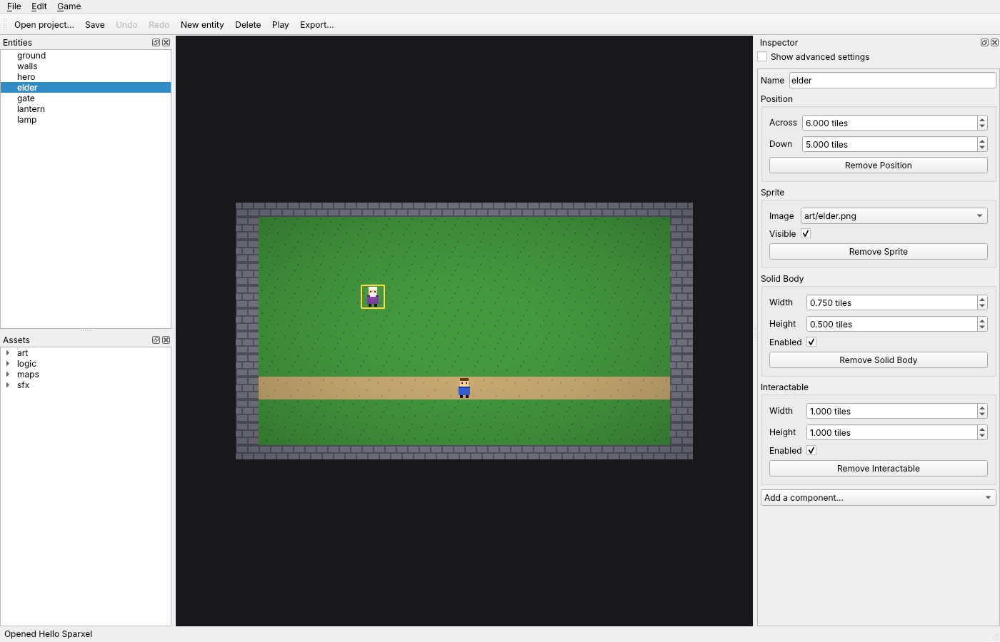

# The editor

> **Status: v0.1.** `sparxel-editor` opens a project folder, draws its scene as the game
> draws it, lists its entities and assets, and edits every component through an inspector
> generated from the reflection registry, paints maps, places pictures, and edits logic as
> plain language. It has undo and redo, saving, Play and Export.
> It is built on Qt 6 Widgets (ADR-005), and tested on Qt's offscreen platform in CI on
> Windows and Linux.
>
> Code: [`editor/core/`](../../editor/core/) (the model, without Qt),
> [`editor/app/`](../../editor/app/) (the Qt application) and
> [`editor/exporter/`](../../editor/exporter/) ([export.md](export.md)). Tests:
> [`tests/editor/`](../../tests/editor/) and [`tests/editor_app/`](../../tests/editor_app/).

## 1. What it is for

The editor is where a creator makes a game without writing code (`plan/06`). This first
version covers the loop every later tool plugs into: open a project, see the scene, select
something, change it, paint its maps, undo, save, play, export.



## 2. Using it

```sh
sparxel-editor samples/hello
```

| Part | What it does |
|---|---|
| **Scene** (middle) | The scene drawn by the engine, as the game draws it: the project's resolution, style, lighting and look, at the largest whole-number scale that fits. **Click** selects what is drawn on top (sprites before maps) and **drag** moves it, to whole pixels, as one undo step: in Classic 2D on the flat map; in the Diorama style through the 3D camera, picking the nearest billboard and dragging along the ground, so the ground under the cursor stays under it. Drag with the right or middle button, or use the arrow keys, to move the camera |
| **Entities** (left) | Every entity, children under their parents. Selecting one selects it everywhere |
| **Assets** (left) | The project's `assets/` folder: pictures, sounds, scenes and logic. **Drag a picture into the scene** to place it where it is dropped (in either style): a new entity named after the file, with a Position at the nearest pixel and a Sprite showing the picture, selected, as one undo step. **Drag a sound into the scene** (WAV, Ogg, FLAC or MP3) to place a **Sound Source** there: the sound on repeat, louder the closer the player comes; its field in the inspector lists the project's sounds. Other files, and files from outside `assets/`, are refused with a message |
| **Tiles** (left) | With a tilemap selected, its tileset's tiles and an eraser. Choosing one puts the scene in **paint mode** (in either style; in 3D the cell is where the cursor meets the ground): the left button paints the tile into the cell under the cursor, the right button erases, the middle button still moves the camera. Each stroke is one undo step; painting past the map's right or bottom edge grows it. Three **tools** sit above the tiles: the **Pencil** paints cell by cell along the stroke; the **Rectangle** is dragged out (a dashed outline shows it) and painted when the button comes up; the **Fill** paints the clicked cell and every cell of the same tile joined to it by its sides, inside the map as it is. Each rectangle and each fill is one undo step, and the right button erases with them too. Choosing the tile again, Escape, or selecting something else stops painting |
| **Inspector** (right) | The selected entity's name, and a group for each component with a field for each property: a tick box for yes/no, number fields with the property's range, step and unit, a list for choices, and a list of the project's pictures for an image or tileset. Read-only properties are shown but cannot be changed; *Show advanced settings* adds the advanced ones. Each group can be removed, and *Add a component…* lists those the entity does not have |
| **Logic** (right, beside the inspector) | Every logic file of the project, its Rules, Sequences and Brains as plain language: *When [who] interacts with it (elder)*, then its steps (*Say “…” (dialogue)*, *Wait until not a message is open (dialogue)*, *If the answer chosen (dialogue) = 1:*), nested as they run. **Editing:** selecting a step shows the values written into it (the words said, the seconds waited, a property's new value) as fields of their kind, with their ranges and choices, and typing changes the line as you type. **Add** puts in, from lists built from the registry and the scene: a **step** (Log, Wait, Repeat, Run a Sequence, **If** or **Wait until** a condition picked from the list, or any action of the game's objects and the scene's entities, by object) after the selected step, first inside a selected If or Repeat, or first under a selected Rule, Sequence or state; a **condition** on the selected Rule or "Go to"; a **Rule** on any event (the game starting, or an object's); a **Sequence**, a **Brain** (with a first state, *idle*), a **state**, a **"Go to"** out of the selected state, or a **new logic file**. Names, a "Go to"'s target and time, and the Sequence a Run step runs are values too; renaming a state or a Sequence renames what refers to it. **Delete** removes any block; **Up** and **Down** move steps, and a step can be **dragged** onto another line to go where a step added there would (after a step, inside an If or Repeat, first under a Rule, Sequence or state; never into itself). **Not** turns the selected condition (or an If's or Wait until's test) into its opposite; a Rule's tick box makes it run when **any** of its conditions holds rather than all, shown as *If any of these:* with each condition on its own line. **Group** puts the selected condition and the one after it into a group of their own, matched the other way from the list they are in (*Any of these:* among conditions that must all hold, *All of these:* inside *any of these*), so groups go inside groups to any depth (*any of: a message is open, or all of: slot 1 and slot 3 have a save*); a selected group has its own tick box for any or all, takes conditions added while it (or one of its conditions) is selected, and **Split** puts its conditions back in its place. Deleting a group's condition down to one leaves that one in the group's place. Conditions and whole groups are **dragged** too: onto a condition to go after it, onto a group or a Rule to go first in it. Steps go into an **Otherwise** from the Add menu's Otherwise list, or by adding while an *Otherwise:* line is selected. **Variables:** each file's are listed under the tree with their name, the value they start with and Delete (refused while a block uses them); Add ▸ Variable makes one (a whole number, a number, yes/no or text), Add ▸ Compare tests one, or a value the Rule's event carries, or a property (*talks ≥ 2*, *[answer] = 1*, *speed of hero > 4*: a condition on a selected Rule or "Go to", else a new If step), and the built-in *Set [variable] to [value]* step changes it. Renaming a variable renames every block that uses it. **Where a value comes from:** each value's **From…** button writes it, or takes it from one of the file's variables, a value the Rule's event carries (*[answer]*), or a property of an object or entity (*speed of hero*), offering only those of the value's kind; numbers can then add, take away, multiply or divide by a written number (*talks + 1*), which stays editable in place, or by another value (*Sum with*: *talks × [answer]*); **Then** adds one more part after a sum, a number to begin with that can in turn come from elsewhere, so sums grow to any length (*(talks × [answer] + 3) × talks*). Parts work in order, each on the result so far, and the line puts brackets where the order would otherwise read differently; *Without the last part* takes one away. Below, the compiler says whether the file runs, or its first problem; each problem also marks its own line in red, with what is wrong as the line's tooltip. Logic edits are steps of the same Undo as the scene's, and Save writes the files that changed |
| **Project** (right, beside the logic) | The project's settings as fields, grouped as a creator thinks of them: the game (name, gravity), the picture (style, size, pixels per tile, background), the Diorama camera, light and shadows (ambient light, sunlight, the sun's direction and height, sprite and block shadows), and the Look (tilt-shift, blur, bloom, grading, vignette). Changes show in the scene as you make them; values the game would refuse are refused with its message; each change is an undo step, and Save writes the project file |
| **Commands** | **New project** (Ctrl+N: asks for the game's name, whether to start in **Classic 2D** or as a **Diorama** (the same game in 3D, lit by the sun, with shadows and tilt-shift), and an empty folder, and makes a small game to start from: a field of grass crossed by a path, stone walls that stop the hero, and a hero moved with the arrow keys, with the tileset and the hero's picture as ordinary files in `assets/art` to draw over), **New scene** (asks for a name; makes an empty `maps/<name>.dscene` and opens it), **Start the game in this scene**, Open, Save (Ctrl+S), Undo and Redo (with what they will undo, for example *Undo Change Speed of hero*), New entity (where the camera looks), Delete, **Play** (F5: saves, then starts `sparxel-player` on the project) and **Export** (saves, asks for an empty folder, then exports: [export.md](export.md)) |

The title shows the game, the scene being edited, and a star while there are unsaved
changes; closing asks whether to save them.

**Scenes.** A project opens in the scene its game starts in. **Double-click a scene** in
the Assets to edit it instead; the open scene is saved first if it changed, and Undo
starts again in the scene opened. Logic belongs to the whole game: a Rule can be about an
entity of any scene, and is checked and read the same whichever scene is open. To move
between scenes in the game, logic uses the Game object's *Go to scene …* steps, and Rules
on *When a scene starts* run on arriving ([game.md](game.md) §8).

## 3. How it works

- **`editor::Document`** (in `editor/core`, no Qt) holds the open project: its settings,
  asset database, a registry of every type the game uses (`game::register_types`), and a
  world with the start scene loaded. Every edit goes through it.
- **Undo by snapshots.** Each edit records the scene before and after, as the JSON the
  scene file holds; undo loads the earlier one. This is correct for every kind of edit
  without one command class per kind. Entities are found again by GUID, which survives a
  reload, so selection survives undo. Consecutive changes to one property of one entity
  (typing, spinning a number, dragging) **merge** into a single step until the field
  loses focus or the drag ends. Scenes are small enough that copying them per edit costs
  nothing noticeable; large scenes will need commands that record only what changed.
- **The inspector knows no component.** It reads each component's `TypeInfo`: display
  names, tooltips, kinds, ranges, steps, units, choices and flags. A component registered
  tomorrow gets its fields with no editor change.
- **`editor::Preview`** draws a Document on a headless GPU device and returns pixels:
  the same `draw_world` / `draw_diorama` and `PostProcessor` the game uses, so what the
  editor shows is what the game shows. The scene view puts those pixels on screen.
- **Logic as language** (`editor::describe`): each Rule, Sequence and Brain becomes
  lines built from the blocks' own reflected texts (`block_text`): an action's text with
  its values filled in, a property's display name, events with their values in brackets,
  and operators as symbols. Members are found on the game's objects by name, and on
  entities through their components, so a new component's blocks read well with no
  editor change. Every line keeps its block id, for highlighting and explaining later.
- **Editing logic** (`Document::logic_slots()`, `set_logic_slot()`, `add_logic_step()`,
  `remove_logic_step()`, `move_logic_step()`): the Document holds the logic files, and
  its undo snapshots hold them beside the scene, so one Undo history covers both and
  Save writes each file that changed. A value's kind, range and choices come from the
  block's reflected parameter or property, and a value that does not fit is refused in
  plain language; typing into one value merges into one step. A new step's values start
  at the parameters' defaults, and it gets a block id no block of the file uses.
  `check_logic()` runs the real compiler against the registry and the scene (the game's
  objects by name, entities through their components, as the game resolves them), so
  renaming an entity a Rule names shows at once.
- **Project settings** (`Document::set_settings()`) go through `project_to_json()` and
  `project_from_json()`, the same check the game runs on its project file, so the editor
  can never save settings the game would refuse. The snapshots behind undo hold them
  beside the scene and the logic; Save writes the project file only when they changed.
- **Picking in 3D** (`editor::pick_diorama`) projects each billboard's corners through the
  game's camera (`diorama_camera()`, which the preview uses too, so they always agree) and
  takes the nearest that covers the point; else the map where the ray from the eye
  (`scene2d::diorama_ray()`) meets the ground (`scene2d::ground_hit()`).
- **Picking** (`editor::pick`) finds the entity drawn on top at a map point in Classic 2D,
  in the draw order the game uses (layer, then y, then GUID): a sprite whose picture
  covers the point, else a tilemap with a tile there.
- **Qt stays in the editor** (ADR-005). The engine and exported games never link it. Qt's
  `emit`, `signals` and `slots` keywords are turned off (`QT_NO_KEYWORDS`), because they
  clash with the engine's own names; the editor uses `Q_EMIT` and `Q_SIGNALS`.
- **Building.** With Qt 6.4 or later found by CMake, the editor is built; without it,
  everything else still builds and a message says the editor was skipped. CI sets
  `SPARXEL_REQUIRE_EDITOR=ON`, so a missing Qt fails the build instead. Linux CI uses
  Ubuntu's Qt 6.4; Windows CI installs Qt 6.8.3 for MSVC with `aqtinstall`
  ([building.md](building.md)).

## 4. Tests

| Test | Checks |
|---|---|
| Opening | The sample's settings, scene and its 7 entities in order; component types sorted by name, behaviours included; a missing project refused |
| Properties | An edit changes the world and marks the scene changed, labelled *Change Speed of hero*; typing three values is one undo step back to the original; after a field loses focus the next change is its own step; a new edit clears redo; a value of the wrong kind and a component the entity lacks are refused, with nothing changed |
| Painting | A stroke over three cells is one undo step; painting past the right edge grows the map, with empty cells between; cells above or left of its corner, and entities without a tilemap, are refused; erasing; a new stroke after `end_merge()` is its own step |
| Entities and components | Create, add a component (twice refused), rename, delete and undo (same GUID and components back), remove a component and undo; a drag of five moves is one step; undoing everything returns to the scene as opened |
| Picking in 3D | Through the sample's Diorama camera: the hero's billboard rectangle lies below the middle of the screen; its middle picks the hero, beside it the ground; the elder; the wall along the bottom edge; nothing in the sky |
| Logic as language | The sample's logic file found and read in full, line for line (its three Rules with their steps, the If and Otherwise, and the weather Brain's states, steps and timed transitions); every line traced to a block; conditions, all-of, not, waits, repeats, runs, Otherwise, event values and an unknown object read sensibly |
| Placing assets | `place_asset()`: the hero's picture at (3.03, 4.94) becomes an entity "hero" at (3, 79/16) with a Sprite showing it, labelled *Place hero*, undone in one step; a logic file, a missing picture and a point that is not a number are refused with messages, recording nothing; a sound becomes an entity "chime" with a Sound Source repeating it (volume 1, range 8, playing) and no Sprite, which saves and reopens as placed |
| Editing logic | The elder's greeting: one value, its text, changed in place (two edits typed, one step); a number is refused for it. A Brain state's ambient light: its range from the registry refuses 3, takes 1. The actions offered, sorted by object. A chime added after the greeting with its default value, compiling; moved up; the first step not moved higher; deleted. A step under a Rule's header goes first; under a Brain, refused; an unknown object refused. Renaming the elder makes the compiler report its Rule; undoing everything returns the logic exactly; redo; saving writes the file and reopening reads the edit |
| Authoring logic | A new file (badly named, existing and escaping ones refused), compiling empty; a Rule on the elder's event from `logic_events()` (an unknown event refused); a condition from `logic_conditions()` (an action refused); steps, including Run and Wait; two Sequences, a Brain with a second state and a "Go to", reading line for line as expected and compiling; renaming the state moves the "Go to"; its time changed; a missing target, a taken name and a bad name refused; Run's Sequence checked, and renaming the Sequence renames the Run; deleting a condition, a "Go to", a state, the Brain, a Sequence and the Rule; undoing everything removes the file, redo brings it back; saving writes it with its `.meta`, and reopening reads it |
| Project settings | Two changes before the merge ends are one step (*Change the project settings*), with the start scene kept; pixels per tile 3 refused with the game's message, changing nothing; undo restores every setting and the project is clean again; redo, save, reopen reads them |
| Logic branches and loops | A Rule on the game starting with an If (slot 3 has a save: its slot a value, changed in place), a Wait until inside it and a Wait after that, and a Repeat 5 times with a Log inside, reading line for line as expected and compiling; an action refused as an If's condition |
| Not, any and Otherwise | A condition turned around (*not*), a second and a third joining an *any of these* group (the third's value edited in place), steps, an Otherwise for the Rule and for an If (whose test is turned around too), line for line and compiling; Otherwise refused on a condition; deleting down to one condition, and back to *all*, splits or dissolves the group; *any* refused with one condition. (This test found that the group's id was taken after its conditions were moved out of the Rule, duplicating one; fixed.) |
| Groups inside groups | Three conditions on a Rule; the last refused for grouping (nothing after it); the first two grouped as *any of these* (one undo step, the Rule itself still *all*), which Not leaves alone; its only two refused for grouping again; a condition added with one of the group's selected joins the group; two of its three grouped as *all of these* inside it, line for line and in the asset's own structure, compiling; a condition deep inside turned around and its value edited; the inner group flipped to *any* and back; deleting one of its two leaves the other in its place; a condition refused for splitting; splitting the inner then the outer gives the four conditions in order, compiling; undo brings both groups back; with one group left on the Rule, the Rule reads as *any*, the group's switch and the Rule's flip it, compiling |
| Moving conditions | A step refused as a condition, a step refused as a place, and a group refused inside itself; a condition onto a group (first in it) and onto a condition (after it), line for line and compiling; onto its own group and onto a Rule that matches any (first); a whole group moved after a condition; the group's last-but-one condition moved out dissolves the group; undo brings it back |
| Variables | Setting one refused before any exists; a whole number and a text made with free names, a choice refused; a start of the wrong kind refused; a Set step whose value is changed, then its variable (the value starting again from that kind's zero), a missing one refused; a comparison as the Rule's condition (≥ 2) and one as an If (≠), a bad operator refused; renaming follows into every block; a taken name refused; deleting refused while used, the unused one deleted; compiling throughout |
| Values from elsewhere | A Set step on *When an answer is picked* takes the answer (*Set talks to [answer]*; the slot reads where it comes from), then talks plus a number (the number written and edited: *talks + 2*), times instead, times the answer (*talks × [answer]*, the slot reading it all); longer sums: one more part after that (+ a written 1, edited to 3, the slot reading *talks × [answer] +*), then × talks, read as *(talks × [answer] + 3) × talks* and built in that order in the asset, compiling, and the last part taken away twice; back to a written number, then no sum; writing a value makes it written again, and a sum or one more part on a written value is refused; a Wait takes the hero's speed (*Wait speed of hero seconds*); the answer compared (*If [answer] = 1*) and the hero's speed (*If speed of hero > 4:*, its value a number), a made-up property refused; only sources of the value's kind are offered, a made-up one refused, and event values only inside a Rule whose event has them; compiling throughout |
| Moving steps | A Log moved into a Repeat (dropped on it: first inside) and a Wait out to first under the Rule, line for line, one undo step each; a Repeat into its own Log, a Rule, and an unknown place refused; undone back to the start |
| Rectangles and fills | A 3 by 2 rectangle between two points in either order, its neighbours untouched; two rectangles are two steps; one past the right edge grows the map and leaves out the part left of its corner; one wholly outside is refused; erasing never grows the map; a fill inside a ring of path stays inside it (nine cells), changes nothing when it is so already, is refused outside the map and on what is not a tilemap, and erases; undo returns the map exactly |
| A new project | An empty name refused, making nothing; the project file, both pictures, the start scene and every `.meta` written; a folder with something in it refused; it opens with no notes: the name, the start scene, three entities, the hero at (10, 6) with a Top-down Mover, a 20 by 12 ground of grass crossed by a path, a solid ring of stone, and the tileset found by its GUID as a 48 × 16 picture; painting and saving work, and reopening finds the edit. Drawn (GPU): the wall's stone, the grass, the path, and the hero's tunic and face at exact pixels. Played in the game's own runtime with recorded input: the hero walks 4 tiles in a second, stops against the east wall and stays there, with no logic errors. The Diorama template opens in the Diorama style and draws differently from the flat one, the grass filling the middle of the picture |
| Scenes | The sample has one scene; a new one refused without a scene's name, outside `assets/`, over an existing file and while changes are unsaved; made, it is open, empty and clean, with its file and `.meta`, and Undo starts again; a bat made in it with an Interactable gets a Rule that checks, as the elder's Rules still do though the elder is in the other scene (`types_elsewhere()`); leaving with unsaved changes is refused; after saving, the village opens as it was and the bat's Rule still checks and reads the same; a missing scene and a picture are refused; *When a scene starts* is offered and its Rule takes *Go to scene “maps/cave.dscene”, arriving at “bat” (game)*; the start scene is set as one undo step, refused for a missing scene, saved, and the project reopens in it |
| Saving | The scene file is written; reopening finds the edit; saving keeps the history |
| Picking | The hero's exact picture bounds; the hero, the elder, the ground and the walls (drawn after the ground) at points, and nothing outside the map |
| Preview (GPU) | The sample drawn at 320 × 180 with the hero's robe and the wall's stone at exact pixels, and the hero moved 2 tiles after an edit |
| The application | Opening the sample: title, list and a 320 × 180 scene. Selecting in the list fills the inspector; a number field edits the world; undo puts it and the field back; renaming in the inspector renames in the list; field labels are never squeezed out of sight. Clicking the hero in the scene selects it; dragging moves it 2 tiles right and 1 down to the nearest pixel, as one undo step; clicking the ground selects it. Painting: the ground's palette has its three tiles and an eraser; a left-button stroke paints a path four tiles long without changing the selection; a right-button click erases; each undoes on its own; the Rectangle tool paints 3 by 3 cells on release (nothing before) as one undo step; the Fill tool erases a joined area with the right button and fills it with stone with the left, leaving the grass around it, one undo step each; Escape and selecting something else stop painting. In the Diorama style: clicking the hero's billboard selects it; dragging it by its feet moves it along the ground to within a picture pixel of where the cursor points, as one undo step; painting puts the tile in the cell under the cursor. A new entity gets a Light from *Add a component…*; saving writes it; deleting and exporting (which saves first) work; exporting over a project is refused. Dragging from the assets: the list's own drag data dropped on the scene (Qt's drag-enter and drop events) places the elder's picture at the map point under the drop, selected and listed, as one undo step; a sound dropped there becomes a Sound Source, selected, with the inspector's sound list (sounds only) showing it; a logic file and a file outside `assets/` are refused with a message in the status bar. The Logic view: selecting the elder's greeting shows its text in a field and "runs: no problems"; typing changes the line as you type, marks the project changed and is one undo step; Delete is enabled for steps only; Add step's menu adds a chime after the greeting, selected; Up moves it before; Delete removes it; Undo goes back through it all; renaming the elder shows the file does not run, and marks exactly the elder's Rule in red with *There is no object called 'elder'.* as its tooltip. The Project view: switching to the Diorama style redraws the scene in 3D and marks the project changed; the sun's direction follows its field; exposure 2 changes the picture; undo puts the numbers back (and their fields), then the style, and the scene is exactly as it was. Dragging: a Log line dropped on a Repeat line (drag-enter and drop events on the tree) goes inside it, stays selected, as one undo step; a loose condition dropped on an *If any of these:* line goes first in the group, still selected, as one undo step. Values from the view: a Set step's From… menu takes the answer of *When an answer is picked* (the field becomes the words *[answer]*), then the variable plus a number, whose field sets it to *variable_1 + 3*, then plus the answer (*Sum with*) and back to a written 1, then (no *Then* menu before there is a sum) times a number from *Then*, whose field sets *(variable_1 + 1) × 4* with *(variable_1 + 1) ×* beside it, and *Without the last part* back to *variable_1 + 1*, compiling; the Compare menu adds *If [answer] = 0* and *If speed of hero = 0* to the Rule. Variables from the view: one made from the menu, renamed in its field and given a start; compared on a Rule and set by a step; its Delete refused, with the reason in the status bar, while it is used. Not, any and Otherwise from the view: the Not button turns a condition around; with a Rule selected the tick box groups its two conditions under *If any of these:*; the Otherwise list adds a Wait to the Rule's Otherwise, and a Log added with the *Otherwise:* line selected joins it. Groups from the view: Group is disabled on a Rule and on the last condition; on the first of three it makes *If any of these:*, selected, with Split and its own tick box (ticked, worded for a group); a condition added with the group selected joins it; two of its three grouped make *All of these:* inside it, flipped to *Any of these:* with its tick box, compiling; Split puts its two back and selects the first of them. New project: over an existing project it is refused with the reason in the status bar and the open project stays; in a new folder it makes the starter game (the name trimmed), opens it, shows it in the title, lists its three entities and no logic, and draws it at 320 × 180; the Diorama starter opens in the Diorama style with tilt-shift on. Scenes from the window: New scene saves the open scene's change, opens the empty cave (in the title and the status bar, the list empty); the same name again is refused with why; a double-click on the village in the Assets opens it with the earlier change kept; the cave kept its entity; *Start the game in this scene* sets it as an undo step; a picture is refused as a scene. Authoring from the Add menu: a new file, a Rule on the game starting, a Wait step, an If (slot 1 has a save) and a Log that goes inside it, a Brain, a state renamed by typing, a "Go to" back to *idle*, "runs: no problems", and saving writes the file and its `.meta` |

## 5. The Windows package

Every build on GitHub makes **`Sparxel-windows`**: a folder that runs on a Windows PC
with nothing else installed. Download it from the build's page (Actions → the latest CI
run → Artifacts), unzip it, and open `sparxel-editor.exe`.

| In the folder | What |
|---|---|
| `sparxel-editor.exe`, `Qt6*.dll`, `platforms/` and other plugin folders | The editor and Qt's libraries, gathered by `windeployqt` |
| `player/` | `sparxel-player.exe` with only its own libraries and notices. The editor plays and exports with it, so exported games never carry Qt |
| `samples/hello` | The sample village, to open first |
| `README.txt`, `LICENSE.txt`, `THIRD_PARTY_NOTICES.md`, `QT-NOTICE.txt`, `qt-licences/` | How to start, and the licence notices: Qt is LGPL, linked dynamically, its libraries left as files that can be replaced |
| `vcruntime140.dll`, `msvcp140.dll` and the rest of Microsoft's C++ runtime, here and in `player/` | So it runs on a PC that never installed it (app-local deployment, taken from the Visual Studio that built it). Exported games copy the player's folder, so they carry it too |

[`tools/package_windows.cmake`](../../tools/package_windows.cmake) makes it from a build.
CI then **checks it with nothing else on the path** (no Qt, no build folder):
`sparxel-editor samples\hello --check` starts the editor, opens the sample and leaves
with 0 only if that worked (in this mode problems never open a dialog), and the packaged
player plays the sample for half a second.

## 6. Next increments

1. **Logic, further:** a part of a sum that is itself a bracketed sum written first
   (*talks × (a + b)*).
2. **Placing a scene** by dragging, as a door to it.
3. **Move gizmos** and multiple selection.
4. **Docking layouts** with Qt Advanced Docking System (ADR-005), saved per user.
5. **More project templates** (a platformer, a visual novel), beside the two there
   are.
6. **An installer** (and a signed one) around the Windows package of §5.
