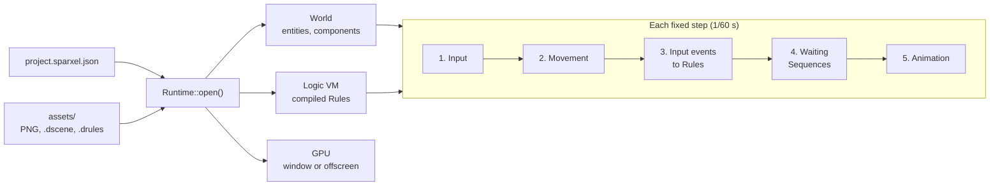

# Game: the Runtime

> **Status: v0.1, the first playable loop.** A project folder on disk (settings, PNG
> images, a scene and Rules) opens and runs: a hero walks with the keyboard or a gamepad,
> Rules react to the game starting, to buttons and to animations finishing, and the game
> draws pixel-perfect into a window that follows the hero. No-code logic reaches the world's entities by name or GUID,
> through all their components. Every behaviour below is covered by tests.
>
> Code: [`engine/game/include/engine/game/`](../../engine/game/include/engine/game/):
> [`runtime.h`](../../engine/game/include/engine/game/runtime.h),
> [`logic_world.h`](../../engine/game/include/engine/game/logic_world.h) and
> [`clock.h`](../../engine/game/include/engine/game/clock.h). Tests:
> [`tests/game/`](../../tests/game/).

## 1. What it is for

`engine/game` connects the engine's parts into a game. The runtime opens a project
folder, loads its settings, assets, start scene and logic, then runs a loop of fixed
steps. An exported game runs exactly this, and the editor's Play button will run it too
(`plan/03` §8).



## 2. A project on disk

```
MyGame/
├── project.sparxel.json
└── assets/
    ├── art/hero.png (+ .meta)
    ├── maps/start.dscene      # a scene file (serialization.md §5)
    └── logic/main.drules      # a logic asset (serialization.md §4)
```

`project.sparxel.json` (`plan/03` §4) holds the settings:

| Entry | Meaning | Default and range |
|---|---|---|
| `format`, `version` | `"sparxel.project"`, version 1 | Required. A newer version asks the user to update Sparxel |
| `name` | The game's name | Required |
| `start_scene` | The scene to start in, a path inside `assets/` | Required |
| `ppu` | Pixels per world unit (one tile) | 16; 8 to 64 (`plan/04` §2) |
| `width`, `height` | The internal resolution, upscaled pixel-perfect | 320 × 180; 16 to 7680 × 4320 |
| `background` | The clear colour, `[red, green, blue]` | `[20, 24, 40]` |
| `render_style` | `"classic_2d"`, the only style so far | `"classic_2d"` |

- Problems are reported in plain language with where they are, for example
  `project.sparxel.json/ppu`: *"This must be a whole number from 8 to 64."* A value out of
  range refuses the project. An unknown entry is reported and ignored.
- `project_to_json()` writes the settings back; reading them again gives the same values
  (tested).

## 3. Running a project

```cpp
std::vector<serialize::Issue> issues;
auto game = game::Runtime::open("MyGame", {}, issues);   // null if it cannot run
while (game && game->frame(seconds_since_last_frame)) {}
```

`Runtime::open()`:

1. Reads the settings, registers the engine's types, and creates the world.
2. Scans `assets/` (writing `.meta` files for new assets) and loads the start scene. A
   missing or unreadable start scene stops the game.
3. Compiles every `.drules` and `.dsequence` asset against the world's entities and loads
   it into the VM. An asset that does not compile is **left out and reported** with the
   block at fault, for example `assets/logic/bad.drules#block-7`; the rest of the game
   still runs.
4. Opens the GPU, an offscreen image at the internal resolution, and a window at the
   largest whole-number scale that fits 1280 × 720. A missing GPU stops the game only if
   graphics were asked for.
5. Emits `game_start`, so Rules such as *"When the game starts: …"* run once.

`RuntimeOptions`:

| Option | Use |
|---|---|
| `graphics = false` | No GPU at all: for tests, servers and tools. The simulation is identical |
| `headless = true` | Draws into the offscreen image only, with no window: for tests and thumbnails |
| `replay` | Plays an input recording instead of the keyboard and gamepads ([input.md](input.md)) |

### Each frame and each step

`frame(seconds)` asks the fixed-step clock (§7) how many steps are due, runs them, then
draws and presents. It returns false when the player closes the window. Each `step()`:

1. **Input.** The step's controls, from the recording or from the operating system.
2. **Movement.** Every enabled Top-down Mover walks (§4).
3. **Input events.** Each action pressed this step emits `input.pressed` with the action,
   so *"When Interact is pressed"* Rules run.
4. **Logic update.** Events that scripts emitted since the last update are delivered,
   then Sequences whose wait is over resume.
5. **Animation.** Sprite animations advance ([scene2d.md](scene2d.md) §3). Each one that
   reached its end sends its entity's **"finished"** event, so *"When the torch's
   animation finishes"* Rules run.

This follows the order in `plan/05` §5 so far; physics, Brains and "continuously" Rules
take their places in it as they arrive.

### Drawing

`draw()` renders the world with `scene2d::draw_world()` ([scene2d.md](scene2d.md)). The
camera follows the first entity with a Top-down Mover, so the hero stays centred. The
window shows the image pixel-perfect with black bars around it ([rendering.md](rendering.md)
§4).

## 4. Behaviours: the Top-down Mover

Behaviours are components that give an entity a capability with no logic to write
(`plan/05` §3.1). The first is **Top-down Mover** (`top_down_mover`):

| Property | Meaning |
|---|---|
| `speed` | Tiles per second, 0 to 64 (default 4) |
| `enabled` | Turn off to stop the player moving, for example in a cutscene |
| `hitbox_width`, `hitbox_height` (advanced) | The feet, in tiles: 0.75 wide and 0.5 deep by default, centred on the bottom of the position |

It walks with the `move_up`, `move_down`, `move_left` and `move_right` actions, so the
arrow keys, WASD and the gamepad's d-pad all work. **Diagonals are as fast as straight
lines** (the direction is normalised; tested).

**Walls.** Solid tilemaps ([scene2d.md](scene2d.md) §4) stop the hitbox exactly at their
edge. Movement is resolved along x, then along y, so walking diagonally into a wall
slides along it at the diagonal speed (tested).

## 5. Logic meets the world

A Rule such as *"When the chest is opened: unlock it, add 10 gold"* names an object, the
chest, and members that live on different components: `unlock` on a Lock, `gold` on a
Purse. `logic_world.h` lets the logic runtime ([logic-runtime.md](logic-runtime.md)) find
that object in the world ([world.md](world.md)), and lets the compiler check the Rule
against it. The runtime does this for every project; on their own:

```cpp
world::World w(registry);
logic::Vm vm(registry);
game::attach(vm, w);   // scripts now reach w's entities

logic::CompiledLogic compiled = logic::compile(asset, registry, game::object_types(w));
vm.load(asset.name, compiled.source);
vm.emit("chest", "opened");
```

### How names resolve

| Name used in logic | Resolves to |
|---|---|
| 32 hexadecimal digits that are an entity's GUID | That entity |
| An entity's exact name, shared by no other entity | That entity |
| A name shared by several entities, or no entity at all | Nothing: the compiler reports *"There is no object called 'barrel'."*, and so does the VM at run time |

GUIDs never change, so the editor will write them into logic assets. Names are for
people, and for logic written by hand while they are unique. The runtime also binds the
`input` object, for conditions such as *"Interact is held"*.

The VM matches an event by the exact name a Rule was written with. So when the engine
sends an entity's own event, such as an animation's "finished", `game::emit()` sends it
under each name that reaches the entity (`names_of()`): its GUID, then its name if no
other entity shares it. A Rule runs once, whichever name it uses (tested).

## 6. Objects made of several parts

- `Vm::set_object_resolver()` lets the VM ask for an object's parts by name whenever a
  script uses one. For an entity, the parts are its components. `sx.call`, `sx.get`,
  `sx.set` and `Vm::emit()` use the first part that has the member asked for.
- **No addresses are kept.** The resolver runs at every access. Adding a component, or
  creating entities, can move a component's data (flecs stores components in tables);
  logic keeps working because it never holds the old address (tested).
- The compiler's `ObjectTypes` gives all of an object's types, and every lookup searches
  across them, so Rules are checked against everything the entity really has.
- Objects bound with `Vm::bind()` still work and take precedence over the resolver.

## 7. The fixed-step clock

`FixedStepClock` (`clock.h`) turns real frame times into a whole number of simulation
steps (1/60 s by default), plus `alpha`, how far the next step has come, for interpolated
drawing (`plan/03` §7).

- Exact frame times give exact steps: 600 frames of 1/60 s are 600 steps (tested), despite
  rounding in the running sum.
- After a long stall, at most `max_steps` (8) run in one frame and the rest of the backlog
  is dropped (reported in `dropped`), so the game recovers instead of spiralling.
- The runtime numbers its steps itself (`Runtime::step_count()`), which is the step
  number input recordings use.

## 8. Tests

| Test | Checks |
|---|---|
| Project settings | A missing file; a round trip; out-of-range values, a wrong style and an unknown entry, each reported at its path; another format or a newer version refused |
| Recorded input | A temporary project on disk. Right held for 30 steps, in frames of one and two steps, walks the hero exactly 2 tiles; the game-start Rule logs once; Cancel does not trigger the Interact Rule, Interact does; the torch's one-shot animation runs its "finished" Rule once, at 0.3 s |
| Diagonals | Right and down for one second move 4/√2 tiles on each axis; a disabled mover stays put |
| Walls | Walking right stops with the hitbox on the wall (x = 2.625 for a wall at 3); adding down slides along it at the diagonal speed |
| Problems | A Rules asset naming a missing object is reported at its block and left out, and the game still runs; a missing start scene stops it |
| Drawing (GPU) | Exact pixels: the hero centred, and after walking one tile the rock drawn 8 pixels to the left |
| Logic and world | Names and GUIDs resolve; an entity's event reaches Rules written with its name and with its GUID, once each; Rules act through several components; logic survives storage moves |
| Clock | Exact stepping, stalls and the step cap |

## 9. Next increments

1. **Walk animations** that follow the Top-down Mover's direction, and touching other
   characters and triggers, so the hero can explore a village and talk to people.
2. **Hot reload while playing:** pass asset changes to the texture cache and reload
   changed logic.
3. **Spawning and destroying from logic,** with entities created by Rules addressable by
   GUID.
4. **"Who" picking** (`plan/05` §2): *"all objects tagged Enemy"*, *"the other object"* in
   a touch event.
5. **A `sparxel-run` player executable** that opens a project folder, and Play in the
   editor (`plan/03` §8).
