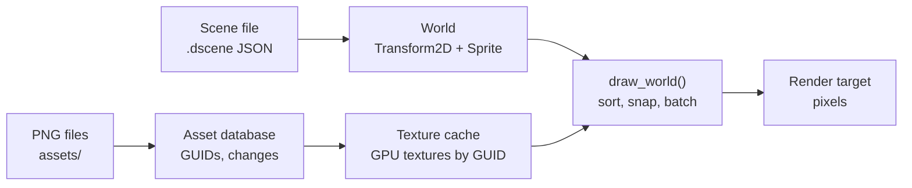

# Classic 2D Scenes

> **Status: v0.2.** Entities with a position and a sprite, whose images are PNG assets
> referenced by GUID, drawn through a pixel-perfect camera. Sprite sheets with frame
> animation, and tilemaps drawn only where they are in view, whose solid tiles block
> movement. Scenes save to JSON and render
> identically after loading, and editing a PNG hot-reloads it. Every behaviour below is
> covered by tests.
>
> Code: [`engine/scene2d/include/engine/scene2d/scene2d.h`](../../engine/scene2d/include/engine/scene2d/scene2d.h)
> and [`src/scene2d.cpp`](../../engine/scene2d/src/scene2d.cpp). Tests:
> [`tests/scene2d/scene2d_test.cpp`](../../tests/scene2d/scene2d_test.cpp).

## 1. What it is for

This is where the engine's parts first work together, in the **Classic 2D** render style
(`plan/04` §3):

The Diorama style (3D world, lit billboards) builds on the same components and caches.

## 2. Components

Both are reflected types, so the inspector, no-code blocks and scene files get them with
nothing extra to write ([reflection.md](reflection.md)).

| Component | Properties | Shown as |
|---|---|---|
| `Transform2D` ("transform_2d") | `x`, `y` in **tiles** (world units), `layer` (advanced) | "Position" |
| `Sprite` ("sprite") | `image` (an asset GUID), `visible`; advanced: `pivot_x`, `pivot_y`, tint red, green, blue, and opacity; `frame_width`, `frame_height` and `frame` for sprite sheets | "Sprite" |
| `SpriteAnimation` ("sprite_animation") | `first_frame`, `frame_count`, `frames_per_second`, `loop`, `playing`; actions *Play* and *Stop*; event *finished* | "Animation" |
| `Tilemap` ("tilemap") | `tileset` (an asset GUID), `tiles`, `visible`, `solid`; advanced: `tile_size` | "Tilemap" |

- **Units:** one world unit is one tile of `ppu` pixels, the project setting (default 16,
  `plan/04` §2). A sprite's size comes from its image: 1 image pixel is 1 world pixel.
  Creators never type sprite sizes.
- **The pivot** is the point of the image placed on the position. The default, bottom
  centre, puts a character's feet on its position, which is what depth sorting needs.

## 3. Sprite sheets and animation

- **Frames.** With `frame_width` and `frame_height` set, the image is a grid of frames,
  numbered from 0 left to right, then top to bottom. `frame` picks one; numbers past the
  last frame wrap around. With a size of 0 (the default) the whole image is one frame, so
  scenes from v0.1 are unchanged.
- **Animation.** `animate(world, seconds)` advances every playing SpriteAnimation and sets
  its Sprite's `frame` to `first_frame` plus the frame reached. It runs once per fixed
  step, so animations are frame-rate independent and replay exactly. At 10 frames per
  second and 60 steps per second, a new frame shows every 6 steps exactly (tested; a tiny
  tolerance absorbs rounding in the running time).
- **Looping or once.** A looping animation starts again after its last frame. One that
  does not loop stops on its last frame, sets `playing` to false, and `animate()` returns
  the entity once, so the runtime can send its **"finished"** event to Rules
  ([game.md](game.md) §3).
- *Play* starts again from the first frame; *Stop* keeps the frame shown. The time played
  so far is a hidden property, saved with scenes.

## 4. Tilemaps

- A Tilemap is a grid of square tiles from one **tileset** image, with its top-left corner
  at the entity's Position. Tiles are numbered like sprite sheet frames. `tile_size` 0
  (the default) uses the camera's pixels per tile, so a tile is one world unit.
- **Stored as text** so scene files stay readable and diff well: one line per row, cells
  separated by commas, each a tile number, or empty (or -1) for no tile. `parse_tiles()`
  reads it strictly; a bad cell is reported by row and column, for example *"Row 2, column
  2 is 'x', which is not a tile number (a whole number from -1 up)."* Short rows are
  filled with empty cells. `format_tiles()` writes it back, and reading that gives the same
  grid (tested).
- **Hostile input:** a map is at most 4,096 tiles on each side. Text cannot make the
  engine allocate more than that.
- The component keeps the parsed grid until its text changes, so drawing does not parse
  every frame. The cache is not reflected, so it is never saved.
- **Drawing** computes the columns and rows in view and draws only those, in one batch per
  tileset: in a 100 × 100 map, an 8 × 8-pixel view of 2-pixel tiles draws 16 tiles, or 25
  when the camera is half a tile off the grid (tested). Tile numbers past the end of the
  tileset are skipped.
- A tilemap sorts like a sprite whose `y` is the map's top edge. Put ground maps on a
  lower `layer` than characters. If an entity has both a Tilemap and a Sprite, the sprite
  is drawn over the map.

### Solid tiles

- With `solid` on, every tile of a map blocks movement. Walls go on their own map; hide it
  if the wall art is painted on another one.
- `sweep(world, box, axis, distance, ppu)` says how far a box (in world units, edges
  half-open) can move along one axis: the whole distance, or up to the edge of the first
  solid tile in the way, or 0 when it already touches one. Moving one axis at a time
  lets characters slide along walls ([game.md](game.md) §4).
- **Exact and safe at the edges:** positions within 10⁻⁹ of a tile edge count as on it, so
  rounding in the sum of many small steps never lets a box slip into a wall. Tiles the box
  already overlaps do not block, so a character placed inside a wall can walk out. Boxes
  with broken (non-finite) positions and maps with invalid text are ignored.
- Only the tile lines between the box and its destination are checked, so the cost does
  not depend on the map's size.

## 5. Drawing

`draw_world(world, textures, sprites, target, camera, clear)` draws every visible entity
that has a Position and a Sprite or a Tilemap.

- **Order:** by `layer`, then by `y` (lower on screen is in front, so characters walk
  behind and in front of each other naturally), then by the entity's GUID. Ties never
  depend on storage order, so the same scene always draws the same way.
- **The camera** (`Camera2D`) has a position in units, the PPU, and a whole-number
  `scale`. Positions are **snapped to whole image pixels before upscaling**, so pixel art
  never shimmers or shows half pixels (`plan/04` §3: "pixel-snapped camera").
- **Missing images** (an unknown GUID, a file that is not a PNG) and tilemaps whose text
  is not valid are counted in `DrawStats::missing` and skipped. An image's error is in
  `TextureCache::last_error()`. `DrawStats::drawn` counts sprites and tiles.

### Keeping the camera on the map

So that the void beyond a map's edges never shows, a game keeps its camera inside the
map ([game.md](game.md) §3):

- `map_bounds(world, ppu)` is the box around every tilemap's grid, visible or not.
- `clamp_view(x, y, view, bounds)` moves the point a camera looks at as little as
  possible, so that `view` (what the camera shows around the point) stays inside
  `bounds`. On an axis where the view is larger than the map, the view is centred on it.
  An infinite edge of the view is never limited.
- In 2D, the view is the screen: half its width and height, in units, either side of the
  point.

## 6. Textures and hot reload

- `TextureCache` loads an image asset onto the GPU the first time it is drawn, and keeps it.
- Pass every `AssetDatabase::refresh()` result to `TextureCache::apply()`. Modified and
  removed images are dropped and reload on their next use. Moved images keep their
  texture, since the GUID and content are unchanged.

A test repaints a PNG on disk from blue to green; after `refresh()` and `apply()`, the next
frame shows green.

## 7. The Diorama style

`draw_diorama(world, textures, renderer, target, camera, clear, light, fog)` draws the same
world in 3D, the HD-2D look (`plan/04` §4). Nothing in the scene changes: a project picks
the style ([game.md](game.md) §2).

- **Space:** a map position (x, y) is the world point (x, 0, y): the ground is the x-z
  plane, up is +y, one unit is one tile.
- **The camera** (`DioramaCamera`) orbits the point it looks at: `pitch` (how far it looks
  down, kept from 5 to 85 degrees), `yaw`, `distance` and a narrow vertical `fov` (30
  degrees by default, the telephoto look of HD-2D). With yaw 0 it stands south of the
  point, so north is up the screen, as in the 2D view. The point is at the centre of the
  image (tested).
- **Sprites** are upright billboards (`plan/04` §5.1, "Upright"): they turn about the
  vertical axis to face the camera, with their pivot on the map position, so feet stand on
  the ground. 1 image pixel is 1/`ppu` of a tile, as in 2D.
- **Tilemaps** are the ground. A Tilemap's `height` turns every tile into a block of that
  many tiles, with the tile's picture on its top and sides; sides are drawn only where no
  neighbouring block hides them (one block is 5 quads; two side by side are 8; tested).
  Layers lift maps a hair (0.002 tiles each), so maps painted over each other do not
  flicker.
- **Lighting** (`DioramaLight`): every face gets `ambient` plus `diffuse` times how much it
  faces the sun (`brightness()`), so tops, sides and sprites shade differently. Tests
  check the exact colours this gives.
- **Light** (`light`): a point light at an entity's position, `height` tiles above the
  ground, reaching `radius` tiles, in its colour times `intensity`; warm torchlight by
  default. The 16 enabled Lights nearest the point the camera looks at are used
  (`diorama_lights()`, ties by GUID), per pixel ([rendering.md](rendering.md) §7). Ground
  and block faces take them from the front; sprites, as billboards, softly from all round
  and in their tint. Lights add to the ambient and sun light, so they show best when
  those are low: the game's `lighting` object sets them ([game.md](game.md) §3). Classic
  2D does not draw lights yet.
- **Depth** sorts everything; there is no draw order to manage. **Fog** fades distant
  things into the haze.
- **What the camera shows** (`diorama_view_extent()`): the ground between where the
  screen's bottom and top edges meet it. Perspective shows more ground above the point
  than below: about 4 tiles below and 9 above with the default camera. The top is
  infinite when the top edge looks above the horizon. The sides are measured at the
  point, so the far corners show a little more. A turned camera (yaw not 0) is not
  limited yet. A test projects each edge through the real camera and finds it exactly
  on the screen's edge.

## 8. Tests

The drawing tests need a GPU and run on lavapipe in CI ([rendering.md](rendering.md) §6);
the others run anywhere:

| Test | Checks |
|---|---|
| Pixel snapping, y-sorting and layers | Exact pixels for two overlapping sprites at 2× scale; the lower one is in front; a higher layer wins; invisible and missing sprites |
| Saved and loaded scene | A scene saved to JSON and loaded into a new world renders **byte-identical pixels** |
| Hot reload | A repainted PNG appears after `refresh()` and `apply()` |
| Editor metadata | Display names, units, categories, flags, actions and events |
| Tilemap text | Parsing, ragged rows, Windows line ends, round trips, every kind of bad cell, the size limits, and the component's cache |
| Animation | Exact frames over 24 steps with looping; a one-shot animation finishing once at 0.3 s; Stop; negative and NaN times ignored |
| Solid tiles | Exact stops in all four directions; touching; rounding either side of an edge; walking out of a wall but not through the next; beside the map; maps not solid, offset, with larger tiles, or broken |
| Diorama (GPU) | Ground under the point looked at, lit from above to the exact shade; sky beyond the map; a sprite standing above the point with the ground in front, shaded as it faces the camera; still facing it a quarter turn later; fog; block faces counted; broken maps and missing images counted |
| Diorama camera and light | `brightness()` for faces up, sideways and down, with any length of normal; the eye's position from pitch and distance; the point at the centre; north up the screen; pitch kept below 90 degrees |
| Camera on the map | `map_bounds()` over maps with offsets, larger tiles and empty maps; `clamp_view()` in the middle, at corners, with a view larger than the map, off-centre and infinite edges, and with broken numbers |
| Lights | `diorama_lights()`: nearest first; disabled, radius 0 and intensity 0 skipped; height clamped to 16; map (x, y) at world (x, z); colour times intensity; at most 16, the nearest |
| A Light on the ground (GPU) | In the dark, the ground under a lamp 1 tile up with radius 2 is exactly 0.5625 of red; dimmer further off; black beyond the radius; black with the lamp off |
| Diorama view extent | For 12 cameras (pitch 20 to 85, field of view 10 to 60), the extent's bottom, top and sides projected through `diorama_view_projection()` land on the screen's edges within 0.01 %; the top is infinite when it looks above the horizon |
| Frames and tilemaps (GPU) | Exact pixels for frames 0, 1 and a wrapped 2; a 2 × 2 map with an empty cell and a skipped tile; a sprite over its map; tiles in view counted for an aligned and an offset camera; bad text and a missing tileset counted |

## 9. Next increments

1. **Animation clips from Aseprite tags,** and directional walk animations for the
   Top-down Mover.
2. **Per-tile collision shapes** from the tileset (half tiles, slopes), and collisions
   between characters, with the physics module.
3. **Several tile layers** and autotiling rules for painting.
4. **2D lights** with normal and mask maps (`plan/04` §3, Classic 2D lighting).
5. **Diorama, further:** point lights and shadows, billboard modes other than Upright,
   directional sprite sets, and tilt-shift depth of field (`plan/04` §5 to §8).
