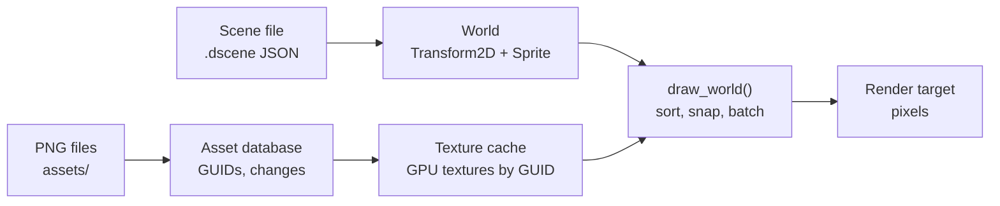

# Classic 2D Scenes

> **Status: v0.1, the first end-to-end pipeline.** Entities with a position and a sprite,
> whose images are PNG assets referenced by GUID, drawn through a pixel-perfect camera.
> Scenes save to JSON and render identically after loading, and editing a PNG
> hot-reloads it. Every behaviour below is covered by tests.
>
> Code: [`engine/scene2d/include/engine/scene2d/scene2d.h`](../../engine/scene2d/include/engine/scene2d/scene2d.h)
> and [`src/scene2d.cpp`](../../engine/scene2d/src/scene2d.cpp). Tests:
> [`tests/scene2d/scene2d_test.cpp`](../../tests/scene2d/scene2d_test.cpp).

## 1. What it is for

This is where the engine's parts first work together, in the **Classic 2D** render style
(`plan/04` §3):

The Diorama style (3D world, lit billboards) builds on the same components and caches.

## 2. Components

Both are reflected types, so the inspector, no-code blocks and scene files get them with
nothing extra to write ([reflection.md](reflection.md)).

| Component | Properties | Shown as |
|---|---|---|
| `Transform2D` ("transform_2d") | `x`, `y` in **tiles** (world units), `layer` (advanced) | "Position" |
| `Sprite` ("sprite") | `image` (an asset GUID), `visible`; advanced: `pivot_x`, `pivot_y`, tint red, green, blue, and opacity | "Sprite" |

- **Units:** one world unit is one tile of `ppu` pixels, the project setting (default 16,
  `plan/04` §2). A sprite's size comes from its image: 1 image pixel is 1 world pixel.
  Creators never type sprite sizes.
- **The pivot** is the point of the image placed on the position. The default, bottom
  centre, puts a character's feet on its position, which is what depth sorting needs.

## 3. Drawing

`draw_world(world, textures, sprites, target, camera, clear)` draws every visible entity
that has both components.

- **Order:** by `layer`, then by `y` (lower on screen is in front, so characters walk
  behind and in front of each other naturally), then by the entity's GUID. Ties never
  depend on storage order, so the same scene always draws the same way.
- **The camera** (`Camera2D`) has a position in units, the PPU, and a whole-number
  `scale`. Positions are **snapped to whole image pixels before upscaling**, so pixel art
  never shimmers or shows half pixels (`plan/04` §3: "pixel-snapped camera").
- **Missing images** (an unknown GUID, a file that is not a PNG) are counted in
  `DrawStats::missing` and skipped. The error is in `TextureCache::last_error()`.

## 4. Textures and hot reload

- `TextureCache` loads an image asset onto the GPU the first time it is drawn, and keeps it.
- Pass every `AssetDatabase::refresh()` result to `TextureCache::apply()`. Modified and
  removed images are dropped and reload on their next use. Moved images keep their
  texture, since the GUID and content are unchanged.

A test repaints a PNG on disk from blue to green; after `refresh()` and `apply()`, the next
frame shows green.

## 5. Tests

They need a GPU and run on lavapipe in CI ([rendering.md](rendering.md) §6):

| Test | Checks |
|---|---|
| Pixel snapping, y-sorting and layers | Exact pixels for two overlapping sprites at 2× scale; the lower one is in front; a higher layer wins; invisible and missing sprites |
| Saved and loaded scene | A scene saved to JSON and loaded into a new world renders **byte-identical pixels** |
| Hot reload | A repainted PNG appears after `refresh()` and `apply()` |
| Editor metadata | Display names, units and categories |

## 6. Next increments

1. **Sprite sheets and animation:** a source rectangle per frame, and animation clips from
   Aseprite tags.
2. **Tilemaps:** tile layers drawn in one batch per atlas.
3. **2D lights** with normal and mask maps (`plan/04` §3, Classic 2D lighting).
4. **The Diorama style:** the same components on billboards in a 3D world.
