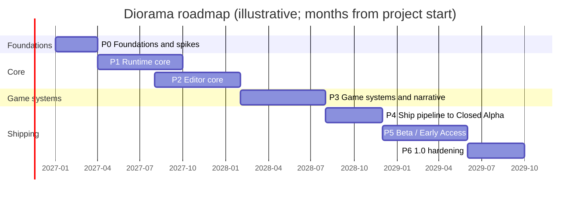
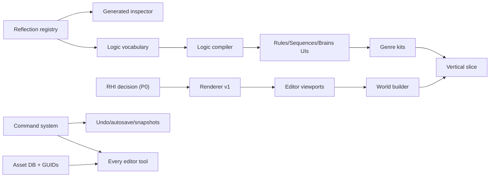

# Plan 08: Roadmap, Milestones and Team

> A phased plan from an empty repository to Diorama 1.0. Each phase ends at a **gate** with
> explicit exit criteria. Work does not move on until the gate passes, which is how scope
> and quality stay under control (`09`, risk R-01).
>
> **The durations are estimates under stated assumptions, not commitments.** They must be
> re-planned at every gate using measured velocity.

---

## 1. Assumptions behind the estimates

- **Team:** a core team of **6–10 people** (§5). For a solo developer or a duo, see §6.
- **Scope:** the α and 1.0 feature tags in `02`.
- **No hidden dependencies:** no console ports, no online services beyond Steam.
- **Reuse:** the library strategy in ADR-000 holds; we do not rewrite physics, audio, VM or
  ECS.

## 2. Phase overview

The calendar dates in the chart are placeholders that assume a January 2027 start. The
relative durations are what matter.

- Adding up the per-phase ranges below, and subtracting the roughly two-month overlap
  between Phases 1 and 2, gives about **26–33 months** of scheduled work. The chart shows
  the upper end, finishing around month 33.
- With a contingency buffer, plan for **about three years** to 1.0 for the assumed team.

## 3. Phases in detail

### Phase 0: Foundations and spikes (≈ 2–3 months)
**Goal:** de-risk the four biggest unknowns before committing to the architecture.

| Work item | Output |
|---|---|
| Repo, CMake/vcpkg, CI (Windows), coding standards, issue tracker | Building skeleton |
| **Spike R: rendering** on the SDL3 GPU API. Reference scene: a diorama village with 50 lit billboard sprites, CSM, 32 point lights, tilt-shift DoF, bloom and fog | ADR-004 decision; first measured budgets (`04` §11) |
| **Spike U: editor shell**, Qt 6 vs WebView2: docking, embedded viewport, reflected inspector, a node widget | ADR-005 decision |
| **Spike L: logic**, visual sample → Logic IR → Luau, with block highlighting, interrupt budgets and a stress test | ADR-007 validation |
| **Spike A: assets**, file watcher → import → cache → hot reload of a sprite into the running viewport | Asset pipeline design confirmed |
| Reference hardware procured (minimum and recommended) | ADR-001 minimum specification fixed |
| Paper prototypes and clickable mock-ups of World, Logic and Sprite Studio, tested with 5 non-coders | UX direction confirmed |

**Gate 0 exit criteria**
- The reference scene runs at ≥ 60 fps at 1080p on minimum-spec hardware, Medium tier, or a
  costed plan exists to get there.
- ADR-004, ADR-005 and ADR-007 are decided and recorded.
- Clickable UX mock-ups score acceptable with non-coders: the Logic mock-up task completes
  in ≥ 70% of attempts.
- ADR-000 has been revisited with the measured velocity.

### Phase 1: Runtime core (≈ 5–6 months)
- Foundation: reflection, job system, memory and logging.
- Platform (SDL3) and RHI backend.
- **Renderer v1:** the Diorama style; sprites with all billboard modes, lighting and
  shadows; the post stack; Looks; texel-density tooling. Classic 2D style. Debug views.
- **World:** flecs integration, scenes, prefabs with overrides, serialization (JSON + GUID).
- **Physics:** the Collision facade with Jolt and Box2D; character controllers.
- **Audio v1:** playback, buses, spatial audio, loops and crossfades.
- **Logic runtime v1:** Luau host, scheduler, Rules, Sequences, Brains and messages.
- Input actions, save/load v1, localization tables, text (FreeType, HarfBuzz, bitmap
  fonts), game UI runtime v1.
- **Packaging v1:** cooked pack and a standalone runtime executable.

**Gate 1:** a hand-authored (JSON) sample scene plays as a standalone `.exe`, with
walking, talking, a cutscene, a save and a load. It meets the performance budget and
passes golden-image tests.

### Phase 2: Editor core (≈ 5–6 months, overlapping Phase 1 by about 2 months)
- **Shell:** workspaces, docking, the command system (undo/redo), autosave and crash
  recovery, snapshots v1.
- **Asset database and browser** with GUIDs, thumbnails, search and safe rename; Project
  Doctor v1.
- **Inspector** generated from reflection, with Basic/Advanced views.
- **World workspace:** Diorama Builder (blocks, face painting, prefabs, scatter,
  auto-rules), entities, regions, Links mode, camera preview, time-of-day scrubber.
- **Sprite Studio v1:** drawing tools, layers, palettes, animation timeline, tags, onion
  skin, normal generator and brush, `.aseprite` import.
- **Look workspace:** presets, sliders and guardrails.
- **Logic v1 UI:** behaviors gallery, Links, Rules editor, live highlight, watches.
- **Play-in-editor** with live editing.

**Gate 2:** in a moderated usability test, **5 of 8 non-coders** build a walkable, lit
village with an NPC conversation and a lever-gate puzzle in **≤ 30 minutes** without docs.
SUS ≥ 68 at this gate (target 75 by alpha).

### Phase 3: Game systems and narrative (≈ 5–6 months)
- **Logic v2:**
  - the Sequence list and timeline editors;
  - the Brain editor with templates;
  - Tables with formulas and curves;
  - the "why didn't this fire?" explainer and event log;
  - the Logic map.
- **Story workspace:** dialogue graph, speakers, text effects, quests, localization
  CSV round-trip.
- **Common kit and RPG kit:**
  - inventory, shops, save points and menus;
  - turn-based battle;
  - party, stats, skills, items and equipment;
  - encounters.
- **UI workspace** with templates, plus automatic gamepad navigation.
- **Audio workspace:** SFX generator, music setup and zones.
- **Characters workspace;** NPC and enemy presets; pathfinding.
- **Internal vertical slice:** a **30–45 minute HD-2D JRPG demo** built *only* in the
  editor by the team's designer and artist, with zero script.

**Gate 3:** the vertical slice is complete and playable start to finish with no script
blocks. Usability round 2 passes ≥ 75% task completion.

### Phase 4: Ship pipeline and Closed Alpha (≈ 3–4 months)
- **Ship workspace:**
  - build profiles;
  - executable branding;
  - Project Doctor blocking checks;
  - standalone test build;
  - third-party notices generation.
- Performance overlay, input record and replay (if it is ready early), and the cheat
  panel.
- Template projects, interactive tutorials, offline docs and example annotations.
- Hardening: importer fuzzing, save compatibility, crash-reporting pipeline.

**Gate 4 (Closed Alpha):**
- 50–100 external testers. All α features from `02` are present.
- The vertical slice is published as a **free demo** on itch.io or Steam, built with the
  public toolchain.
- The crash-free session rate is at least 99% (target 99.5% by 1.0).

### Phase 5: Beta / Early Access (≈ 5–6 months)
- **More genre kits:** Tactics, Action-Adventure, Platformer and Adventure.
- **Rendering:** the Retro 3D style, baked lighting and probes, terrain, level streaming.
- **Logic:** Custom Blocks, optional Luau scripting, input replay.
- **Steam forms:** achievements, stats, leaderboards and cloud saves; upload helper;
  patch builds.
- **Team features:** Git UI, asset locking, merge tools.
- **Editor:** accessibility pass (screen reader for custom widgets), translations, player
  accessibility options template.

**Gate 5:** an Early Access release, with community feedback loops in place. Third-party
games are in production.

### Phase 6: 1.0 hardening (≈ 3–4 months)
- File-format freeze with migration guarantees, an LTS policy and performance polish.
- Documentation completeness and stability.

**Gate 6 (1.0):**
- All 1.0 features from `02` are present.
- Every success metric in `01` §6 is met.
- At least one third-party game has shipped commercially (aspirational).

### After 1.0
- Plugin SDK (C++), editor extension API and a marketplace.
- Mod and Workshop support, AI assistant (opt-in) and the 3D-to-pixel baker.
- Shader graph and palette-locked lighting.
- Vulkan backend hardening, Steam Deck support and a Linux runtime.
- Cloud collaboration.

## 4. Critical path and dependencies

**Items that block everything else, so they are done first and done well:**

1. The reflection registry.
2. The command system.
3. The asset database with GUIDs.
4. The RHI decision.
5. The logic compiler.

## 5. Team composition (core team scenario)

| Role | Headcount | Owns |
|---|---|---|
| Tech lead / engine architect | 1 | Foundation, reflection, ECS integration, architecture integrity |
| Rendering engineer | 1–2 | RHI, renderer, Looks, performance |
| Tools / editor engineers | 2–3 | Qt shell, command system, World, Sprite Studio, Logic UIs |
| Gameplay systems engineer | 1–2 | Logic runtime and compiler, kits, physics, audio |
| UX designer / researcher | 1 | Workflows, usability testing, glossary, onboarding |
| Technical artist / pixel artist | 1 | Look presets, template art, Sprite Studio requirements, golden images |
| QA, docs and community | 1 | Test plans, docs, tutorials, alpha and beta programmes |
| Producer (part-time or combined with lead) | 0.5 | Gates, scope, risk register |

## 6. Solo or small-team scenario

If the project starts with one or two people, which is plausible given this repository,
the plan still works, but the order and scope change:

1. **Keep Phase 0 unchanged.** The spikes are even more important when resources are
   scarce.
2. **Cut α scope to a "Minimum Lovable Engine":**
   - Diorama style only (no Retro 3D);
   - RPG kit only;
   - Links, Rules and Sequences, with Brains as templates only;
   - Sprite Studio covering drawing and animation, with `.aseprite` import as the
     professional path;
   - no team features.
3. **Lean harder on imports at first.** Aseprite and LDtk imports let you defer parts of
   Sprite Studio and the 2D map editor.
4. **Pick one strong vertical slice** and build the engine *for* it.
5. **Expect a much longer timeline.** A full 1.0 as specified is a multi-year effort even
   for the core team. Re-plan at every gate.

## 7. First 30 days (concrete next steps)

| Week | Actions |
|---|---|
| 1 | Approve this plan and answer the open questions in `09` §5. Choose a working product name (trademark check). Set up the repository structure, CMake, vcpkg and CI. |
| 2 | Write coding standards and the folder layout. Draft the reflection registry API (it drives everything). Order the reference hardware. |
| 3 | Start Spike R (rendering) and Spike L (logic) in parallel. Paper-prototype the World and Logic workspaces. |
| 4 | Start Spike U (Qt vs WebView2). Run the first usability test of the paper prototypes with 5 non-coders. Write up interim spike findings. |
